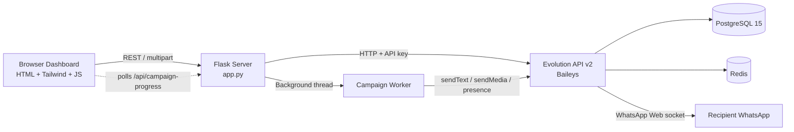

# ⚡ PulseCast WA (`pulsecast-wa`)

**Universal WhatsApp Broadcast, Dynamic Personalization & Anti-Ban Engine**


**PulseCast WA** is a self-hosted, zero-per-message-cost WhatsApp campaign dashboard. Built with **Flask**, **Evolution API v2 (Baileys)** and **TailwindCSS**, it lets businesses, agencies, e-commerce stores, event organizers and developers send personalized multimedia broadcasts from their own WhatsApp or WhatsApp Business numbers, with built-in anti-ban behavior.

---

## 📑 Table of Contents

- [Key Features](#-key-features)
- [Architecture](#️-architecture)
- [Project Structure](#-project-structure)
- [Quick Start](#-quick-start)
- [Configuration](#️-configuration)
- [Running a Campaign](#-running-a-campaign)
- [CSV Format & Personalization](#-csv-format--personalization)
- [API Reference](#-api-reference)
- [Anti-Ban Best Practices](#️-anti-ban-best-practices)
- [Security Notes](#-security-notes)
- [Troubleshooting](#-troubleshooting)
- [Roadmap](#️-roadmap)
- [Contributing](#-contributing)
- [License](#-license)
- [Disclaimer](#️-disclaimer)

---

## ✨ Key Features

- **🔗 Instant Browser QR Pairing:** Link or switch multiple WhatsApp / WhatsApp Business instances from the dashboard, with live connection-state polling.
- **🎯 Universal Dynamic Variables (`{column}`):** Upload *any* CSV. Every column header becomes a clickable `{tag}` button in the UI (e.g. `{name}`, `{company}`, `{offer}`, `{coupon}`, `{invoice_id}`).
- **📱 Live WhatsApp Phone Preview:** A real-time mockup shows how your message, dynamic tags and media will look on the recipient's device before you launch.
- **📎 Rich Media Broadcasting:** Attach PDF catalogs, images (`.jpg`, `.png`) or videos (`.mp4`) via URL, with automatic MIME-type detection.
- **🛡️ Smart Anti-Ban Protection:**
  - Configurable **min–max random delay** between messages (e.g. 8s–16s) to mimic human behavior.
  - Built-in **"typing..." presence emulation** (`2500ms`) before every dispatch.
- **📊 Real-Time Telemetry & Controls:** Live progress bar, KPI counters (`Contacts`, `Sent ✅`, `Failed ❌`), scrolling terminal logs and an instant **Stop Campaign** kill-switch.
- **🧹 Smart Number Sanitization:** Strips spaces, symbols and leading zeros, and auto-prefixes 10-digit numbers with your default country code.
- **🌗 Adaptive Glassmorphic UI:** Light and dark themes with animated RGB gradient borders.

---

## 🏗️ Architecture



| Layer | Technology | Role |
| :--- | :--- | :--- |
| **Frontend UI** | HTML5, TailwindCSS, Vanilla JS | Dashboard, CSV parser, live preview, telemetry polling |
| **Backend Server** | Python, Flask, Pandas | Threaded campaign orchestrator, CSV sanitization, REST proxy |
| **WhatsApp Engine** | Evolution API v2 (`WHATSAPP-BAILEYS`) | Multi-device socket management and media dispatch |
| **Persistence & Cache** | PostgreSQL 15 + Redis (Alpine) | Session storage, device credentials, state caching |

---

## 📂 Project Structure

```text
pulsecast-wa/
├── app.py                 # Flask server, Evolution API proxy, background broadcast worker
├── index.html             # Single-page dashboard (root or ./templates)
├── docker-compose.yml     # Evolution API v2 + PostgreSQL 15 + Redis stack
├── requirements.txt       # flask, requests, pandas, python-dotenv
├── .env.example           # Environment variable template
├── .gitignore             # Excludes .env, venv, pgdata, __pycache__
└── README.md              # Project documentation
```

---

## 🚀 Quick Start

### Prerequisites

- **Docker & Docker Compose** (runs the Evolution API v2 backend)
- **Python 3.10+** and `pip`
- A WhatsApp or WhatsApp Business account on a phone

### 1. Clone the repository

```bash
git clone https://github.com/yourusername/pulsecast-wa.git
cd pulsecast-wa
```

### 2. Configure environment variables

```bash
cp .env.example .env
```

Then **change `AUTHENTICATION_API_KEY`** to your own secret (see [Configuration](#️-configuration)).

### 3. Launch the Evolution API backend

```bash
docker compose up -d
```

Verify it is running at <http://localhost:8080>.

### 4. Install dependencies and start PulseCast WA

```bash
python -m venv venv

# Windows
venv\Scripts\activate
# macOS / Linux
source venv/bin/activate

pip install -r requirements.txt
python app.py
```

### 5. Open the dashboard

Go to <http://localhost:5000>.

---

## ⚙️ Configuration

| Variable | Default | Description |
| :--- | :--- | :--- |
| `EVO_URL` | `http://localhost:8080` | Base URL of your Evolution API instance |
| `AUTHENTICATION_API_KEY` | `PulseCastSecretKey2026` | API key shared by Flask and Evolution API. **Change it in production** and keep it identical in `.env` and `docker-compose.yml` |
| `DEFAULT_COUNTRY_CODE` | `91` | Prefix added to 10-digit numbers |
| `FLASK_PORT` | `5000` | Port for the dashboard |
| `FLASK_DEBUG` | `true` | Set to `false` in production |

Example `.env`:

```env
EVO_URL=http://localhost:8080
AUTHENTICATION_API_KEY=change-me-to-a-long-random-string
DEFAULT_COUNTRY_CODE=91
FLASK_PORT=5000
FLASK_DEBUG=false
```

---

## 📖 Running a Campaign

1. **Link your WhatsApp device**
   - Enter an instance name in the top bar (e.g. `PulseCast_Main`) and click **Link WhatsApp**.
   - Scan the QR code: *WhatsApp → Settings / Menu → Linked Devices → Link a Device*.
   - The status badge turns green (**Connected**) once paired.

2. **Upload your contacts CSV**
   - Click **⬇ Sample CSV** for a template, or upload your own `.csv`.
   - See [CSV Format](#-csv-format--personalization) below.

3. **Compose your message and attach media**
   - Click any auto-generated `{column}` pill to insert a placeholder (case-insensitive).
   - *(Optional)* Paste a direct link to a `.pdf`, `.png`, `.jpg` or `.mp4` in **Media Attachment URL**.
   - Check the **Live Phone Preview** to confirm the result.

4. **Set anti-ban delays and launch**
   - Adjust the **Min Delay** and **Max Delay** sliders (recommended: 10s–25s for larger lists).
   - Click **🚀 Launch Broadcast** and watch the **Live Telemetry** panel.
   - Use **Stop Campaign** at any time to halt after the current contact.

---

## 📇 CSV Format & Personalization

- The file **must** contain a phone column named `Phone`, `Mobile`, `Number` or `WhatsApp` (case-insensitive).
- Every other column becomes a usable `{variable}`.
- 10-digit numbers get `DEFAULT_COUNTRY_CODE` prepended. Numbers that already include a country code are cleaned and used as-is.

Example `contacts.csv`:

```csv
Name,Phone,Company,Offer
Alex Carter,919800000001,Apex Studio,25% OFF
Priya Nair,919800000002,Nova Tech,Free Onboarding
Sam Lee,9800000003,Zenith Retail,VIP Early Access
```

Example message:

```text
Hi {name} 👋
Exclusive for {company}: enjoy {offer} this week only!
```

Rendered for the first row:

```text
Hi Alex Carter 👋
Exclusive for Apex Studio: enjoy 25% OFF this week only!
```

---

## 🔌 API Reference

| Method | Endpoint | Description |
| :--- | :--- | :--- |
| `GET` | `/api/connect/<instance_name>` | Creates or connects an Evolution API instance and returns the pairing QR code (base64) |
| `GET` | `/api/status/<instance_name>` | Returns connection state: `open`, `connecting`, `disconnected` or `offline` |
| `DELETE` | `/api/logout/<instance_name>` | Logs out and unlinks the WhatsApp instance |
| `POST` | `/api/start-campaign` | Accepts `multipart/form-data` (`file`, `message`, `media_url`, `min_delay`, `max_delay`, `instance_name`) and starts the background broadcast thread |
| `POST` | `/api/stop-campaign` | Gracefully halts the active broadcast after the current contact |
| `GET` | `/api/campaign-progress` | Returns JSON telemetry: `running`, `total`, `sent`, `failed`, `current_lead`, `logs` |

Example: start a campaign with `curl`:

```bash
curl -X POST http://localhost:5000/api/start-campaign \
  -F "file=@contacts.csv" \
  -F "message=Hi {name}, your offer: {offer}" \
  -F "media_url=https://example.com/catalog.pdf" \
  -F "min_delay=10" \
  -F "max_delay=20" \
  -F "instance_name=PulseCast_Main"
```

---

## 🛡️ Anti-Ban Best Practices

- **Warm up new numbers:** Don't blast hundreds of messages from a freshly registered number on day one.
- **Use generous random delays:** Keep delays between 12 and 30 seconds for sessions over 100 messages.
- **Personalize content:** Use multiple variables (`{name}`, `{company}`, `{offer}`) so every payload is unique.
- **Target opted-in contacts:** Message customers or leads who have interacted with you, to minimize spam reports.
- **Offer an opt-out:** Add a line like "Reply STOP to unsubscribe" and honor it.
- **Spread large lists over time:** Split big campaigns across hours or days instead of one long run.

---

## 🔐 Security Notes

- Never commit `.env`. It is already listed in `.gitignore`.
- Replace the default `AUTHENTICATION_API_KEY` before exposing anything beyond localhost.
- Set `FLASK_DEBUG=false` in production.
- Don't expose ports `5000` or `8080` publicly without a reverse proxy (Nginx/Caddy), HTTPS and authentication.
- Treat uploaded CSVs as personal data: don't store or share them longer than needed.

---

## 🧰 Troubleshooting

| Problem | Fix |
| :--- | :--- |
| QR code doesn't appear | Check `docker compose ps`, then view logs with `docker compose logs evolution-api` |
| Status stuck on `connecting` | Log out via the dashboard, delete the instance, and re-link |
| `401 Unauthorized` from Evolution API | `AUTHENTICATION_API_KEY` in `.env` and `docker-compose.yml` must match |
| Messages marked failed | Verify the number is on WhatsApp and the country code is correct |
| Media not delivered | Use a direct, publicly reachable URL ending in `.pdf`, `.png`, `.jpg` or `.mp4` |
| Port already in use | Change `FLASK_PORT` in `.env` or free the port |

---

## 🗺️ Roadmap

- [ ] Scheduled campaigns
- [ ] Campaign history and CSV export of delivery reports
- [ ] Multiple message variants (A/B testing)
- [ ] Built-in opt-out / blocklist management
- [ ] Multi-instance rotation for large lists
- [ ] Optional dashboard login

---

## 🤝 Contributing

1. Fork the repository
2. Create a feature branch: `git checkout -b feature/your-feature`
3. Commit your changes: `git commit -m "Add your feature"`
4. Push the branch: `git push origin feature/your-feature`
5. Open a Pull Request

---

## 📄 License

Released under the [MIT License](LICENSE).

---

## ⚠️ Disclaimer

This tool is built for educational purposes, CRM notifications and legitimate customer outreach. It uses the open-source Evolution API (Baileys) and is **not affiliated with, endorsed by, or certified by WhatsApp or Meta Platforms, Inc.** Use it responsibly and in accordance with WhatsApp's Terms of Service. You are solely responsible for complying with applicable messaging and data-protection laws.